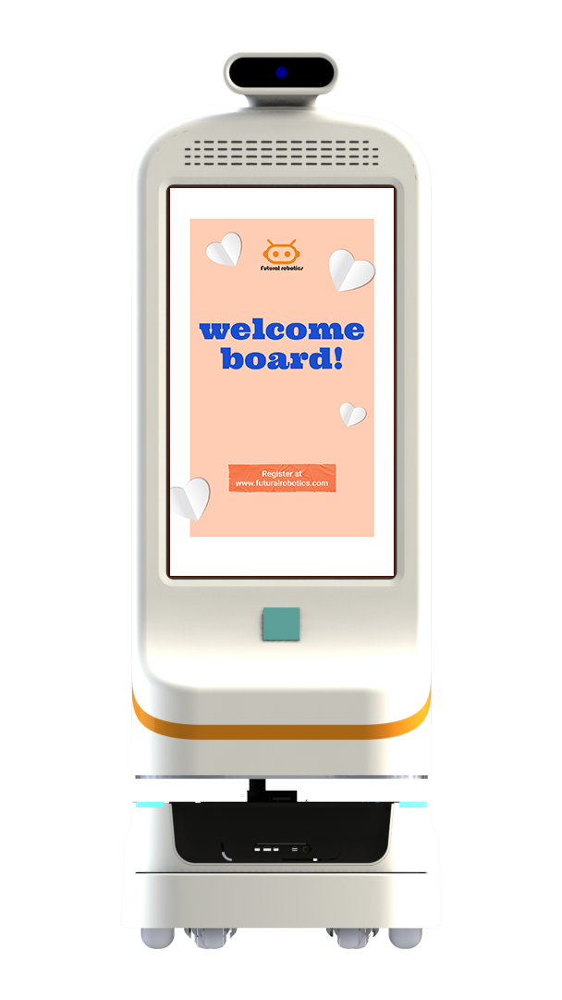

走进医院门诊大厅，第一道压力往往是「去哪、找谁、怎么办」。迎宾导医机器人正尝试把这道压力接过去——前提是它真的能听懂、会答、带对路。

## 门诊导诊的人工压力
门诊大厅的咨询台常年排着问路的队伍：科室在哪、检查怎么走、业务去哪办。这类高频、重复、标准化的问题，既占用人工，又在前高峰时段形成拥堵，是导诊分流的典型场景。

## 小晴 FW-24M 的交互能力
双擎科技小晴（FW-24M）配备 23.8 英寸屏，支持 AI 大模型、人脸识别、展厅讲解、带路与业务咨询，可在门诊大厅承担迎宾接待、就医引导与基础咨询，把一部分标准化问询从人工窗口分流出来。

## 知识库问答支撑专业应答
双擎为机器人端提供知识库问答系统，结合 AI 大模型能力，对常见就诊流程、科室位置、业务咨询等问题作答，并把复杂或敏感诉求稳妥引导至人工，形成「机器先答、人工兜底」的协作。

## 与整院机器人服务协同
迎宾导医并非孤立设备。在双擎-AMR 医院柔性物流整体解决方案中，导医机器人与配送机器人、消毒机器人、RCS 调度中枢一同构成整院服务网络，从「引导人」延伸到「运送物」，提升整体就诊体验。

---

> 来源：双擎科技（杭州）有限公司（Futural Robotics）｜官网 [www.futuralrobotics.com](https://www.futuralrobotics.com/)
> 本文内容用于行业方案说明，事实信息以公司公开资料为准。

## 常见问题

### 医院迎宾导医机器人能做什么？

以双擎小晴（FW-24M）为代表，配备 23.8 英寸屏，支持 AI 大模型、人脸识别、展厅讲解、带路与业务咨询，可在门诊大厅承担迎宾、分流咨询与带路引导。

### 导医机器人怎么回答专业问题？

双擎为机器人端提供知识库问答系统，结合 AI 大模型能力，可对常见就诊流程、科室位置、业务咨询等问题作答，并把复杂诉求引导至人工窗口，形成人机协作。

### 双擎迎宾导医机器人有哪些型号？

除小晴 FW-24M 外，还有 Peggy（FW-24M）、小双（FW-27M，27 英寸屏）、小青/小擎（FW-22M）等，覆盖不同屏体与交互场景的迎宾、导医与讲解需求。

