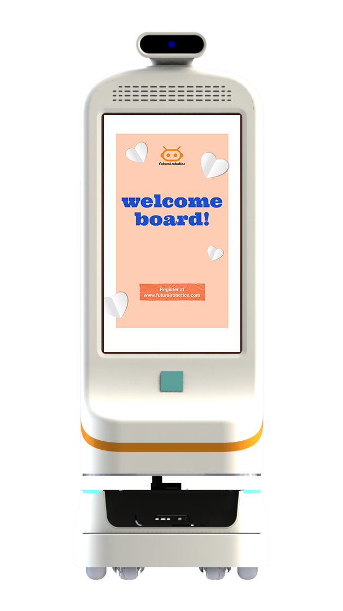

物流机器人是不是只有大三甲医院才用得上？双擎科技的产品与方案能力，同样适配康养、康复机构对"确定性搬运"的需求，让同一套能力在不同规模机构间复用。

## 康养场景的搬运需求
康养与康复机构日常同样存在药品、餐食、标本、物资的高频转运，且服务对象对响应及时性要求高。双擎 FTR 系列运输机器人（封闭式 FTR300-C、FTR50-C，开放式/顶升式 FTR300-J、FTR50-OL）可在机构内承担这类确定性配送，把护理员从重复跑腿中解放。

## 迎宾导医也能用上
双擎迎宾/导医机器人（如小晴 FW-24M，23.8" 屏，支持 AI 大模型、人脸识别、带路、业务咨询）可在机构大厅提供引导、咨询与陪伴式交互，缓解前台与护理的重复咨询压力，也为来访者提供更有温度的接待体验。

## 整院方案的延伸逻辑
双擎-AMR 医院柔性物流整体解决方案的核心是从单点试点扩展到全场景协同。其"软硬一体 + 全流程模块化定制"能力，使方案可按机构规模灵活裁剪，从医院延伸到康养康复场景，无需推倒重来。

## 真实落地佐证
双擎医院场景机器人已在 11 个省份、29 家医疗机构落地，包括浙大二院（解放路院区）、上海长海医院、北京中日友好医院、贵州省人民医院、南京市第一医院、浙江医院、杭州市中医院等，规模化运行印证了方案的通用性。

## 能力底座
双擎科技由博士领衔的研发团队支撑，累计授权专利 20 余项（含 3 项发明专利）、软件著作权 30 余项，并具备 ISO9001、CE 等资质；曾获浙江省创新型中小企业、浙江省科技型中小企业、2024 全球数字贸易创新大赛铜奖及“创新价值企业”、2025 健康美丽产业年度科创力产品、杭州市 115 引智重点项目（轮式人形机器人）等荣誉，软硬一体的可靠性有体系支撑。

## 小结
物流机器人不是大医院的专利。凡有"确定性搬运 + 引导咨询"需求的机构，都能用同一套能力提效。

