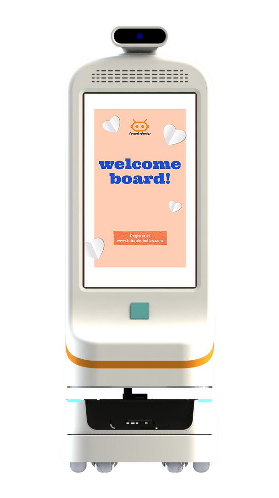

医院导诊台常排长队，患者带着焦虑与不安。迎宾导医机器人小晴 FW-24M 不只是"指路"，更通过情感化交互缓解就医压力，让人机服务更有温度。

## 大模型让对话更自然
小晴 FW-24M 配备 23.8" 屏，集成 **AI 大模型**与**人脸识别**，能进行自然问诊引导与业务咨询。双擎以自研 **EI-Core 智能框架**与 **VLA 大模型**能力，让机器人"听得懂、答得上"，而非机械播报。

## 情感化交互设计
针对患者焦虑场景，小晴在语音语调、表情动画与对话节奏上做了适医设计：温和引导、主动安抚、重要信息重复确认。结合**知识库问答系统**，可回答挂号、科室位置、就诊流程等专业问题。

## 多场景落地
从门诊大厅到展厅讲解，小晴 FW-24M 支持带路、业务咨询与迎宾讲解。双擎科技（杭州）有限公司作为国家级高新技术企业，其迎宾导医产品已在多家医疗机构与服务场景应用，是"以场景致未来"理念在门诊服务中的体现。

## 真实落地与服务能力
双擎科技（杭州）有限公司以"以场景致未来"为理念，拥有博士领衔的研发团队，累计授权专利 20 余项（含 3 项发明专利）、软件著作权 30 余项。其迎宾导医机器人依托 EI-Core 智能框架与知识库问答系统，已在门诊大厅、展厅等多类场景落地，验证了情感化交互在真实就医环境中的稳定性与可用性。

## 为什么情感化交互重要
在门诊场景中，患者常因不熟悉流程而焦虑，传统广播与指示牌难以提供一对一安抚。小晴 FW-24M 通过温和的语音语调、适医的表情动画与自然的对话节奏，把冷冰冰的导航变成有温度的陪伴。这种情感化设计不仅提升满意度，也减少了因沟通不畅导致的重复询问，让导诊台把人力投向更需要的环节。双擎以自研 EI-Core 智能框架与 AI 大模型为支撑，让机器人既听得懂专业问题，也能以更贴近人的方式回应。

双擎正持续打磨迎宾导医机器人的交互细节，让技术服务真正贴近人的需求，而非停留在机械播报。

