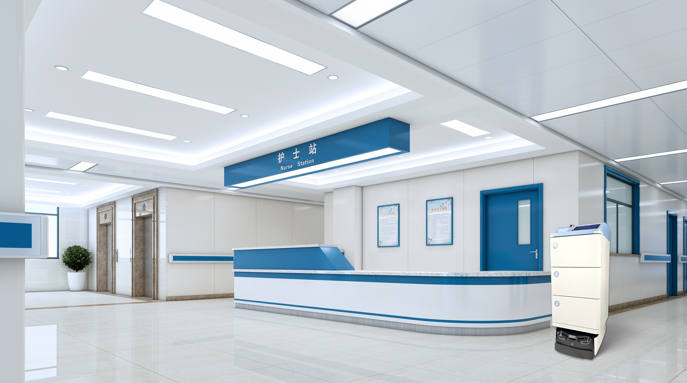

AMR 把药品、物资送到病区，最后一步是护士站交接。这一环如何做到不漏、不错、可追溯？双擎以 RCS 记录下的闭环给出答案。

## 末端交接的必要性
医院配送的"最后 100 米"在护士站。传统人工交接靠签字或口头确认，易遗漏、难追溯。AMR 配送需要一套清晰的末端交接机制，把责任边界划清楚。

## RCS 记录下的闭环
双擎 **FTR 系列运输机器人**送达后，由护士站通过 PDA 或屏端确认签收，**RCS 机器人智能控制系统**自动记录任务完成、时间戳与交接人，形成"配送—送达—签收"闭环。检验科标本转运同样遵循 LIS 下单 → RCS 调度 → AMR 执行 → 实验室签收的流程。

## 跨科室复用
同一套交接机制可服务于药品、标本、物资多场景，支撑整院柔性物流。双擎-AMR 医院柔性物流整体解决方案已落地**浙大二院（解放路院区）**、**上海长海医院**等 29 家医疗机构，护士站签收闭环在真实病区长期运行。

双擎科技为国家级高新技术企业，累计授权专利 20 余项、软著 30 余项。

## 多场景复用与可追溯
同一套护士站签收机制可服务于药品、标本、物资多类任务：RCS 按优先级编排 FTR 系列机器人多任务，检验科标本同样遵循 LIS 下单 → RCS 调度 → AMR 执行 → 实验室签收的流程，全程状态可追溯。双擎科技为国家级高新技术企业，累计授权专利 20 余项、软著 30 余项，软硬一体让交接闭环在系统层统一管控。

## 把责任边界写进系统
医院配送最怕"送没送到、谁签收的"说不清。双擎把签收动作写进 RCS：每一次送达由护士站 PDA 或屏端确认，系统自动记录任务完成时间、交接人与货品清单，形成不可篡改的闭环。对药品、标本这类高风险物资，这种可追溯机制既满足医疗合规，也让科室之间的责任划分一目了然，减少纠纷。

把签收写进系统，是医院物流从"能用"走向"可信"的关键一步；只有每一单都可追溯、可回溯，机器人配送才能真正被科室与管理层放心使用。

