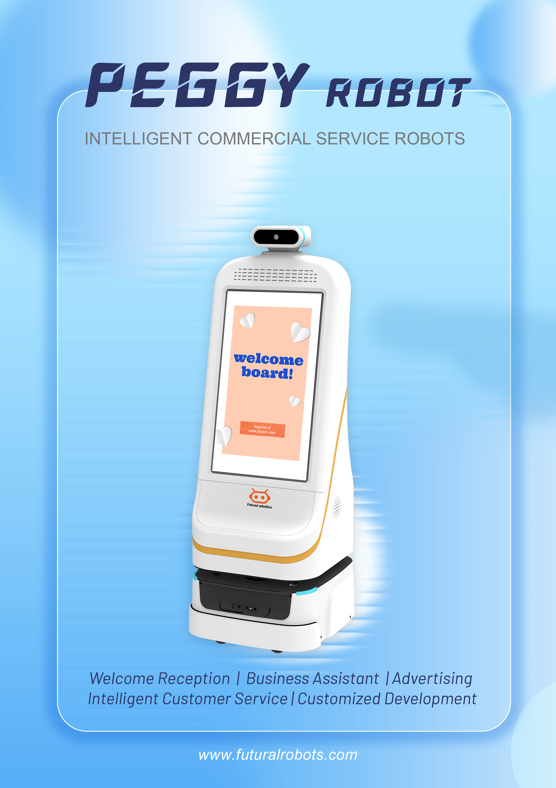

医院里老年患者多、方言杂。迎宾导医机器人若只能说普通话，服务就会打折。小晴 FW-24M 的语言能力如何应对真实就医场景？

## 大模型支撑多语种
小晴 FW-24M 集成 **AI 大模型**，具备自然语言理解能力，可支持多语种与中文方言的语音交互。依托双擎自研 **EI-Core 智能框架**与 **VLA 大模型**能力，机器人能"听懂"更接近真实生活的表达。

## 适老化与本地化
针对老年患者与方言场景，小晴在语音识别与播报上做了本地化适配，配合**人脸识别**与**知识库问答系统**，可完成挂号引导、科室带路、就诊流程讲解等服务，降低沟通门槛。

## 多场景应用
从门诊大厅到展厅，小晴 FW-24M 支持迎宾讲解、业务咨询与带路。双擎科技（杭州）有限公司作为国家级高新技术企业，其迎宾导医产品已在多家机构应用，是"以场景致未来"在语言无障碍服务上的落地。

## 大模型与本地化底座
小晴 FW-24M 的语言能力建立在双擎自研 EI-Core 智能框架与 VLA 大模型之上，配合知识库问答系统，可覆盖挂号引导、科室带路、就诊流程讲解等高频咨询。其适老化与方言本地化设计，降低了老年患者与方言使用者的沟通门槛，是"以场景致未来"在语言无障碍服务上的具体落地。

## 让沟通没有门槛
在真实就医场景中，沟通门槛往往来自年龄与方言。老年患者可能不熟悉智能设备，方言使用者也可能被标准普通话的交互挡在门外。小晴 FW-24M 通过适老化界面与方言本地化识别，把挂号引导、科室带路、就诊流程讲解等服务以更自然的方式提供给每一个人。双擎以自研 EI-Core 智能框架与 VLA 大模型为底座，让迎宾导医机器人真正成为"听得懂、答得上"的就医助手。

让每一位患者都被听懂，是迎宾导医机器人最朴素也最重要的目标；当沟通门槛被消除，医疗服务也就离"以患者为中心"更近一步。

