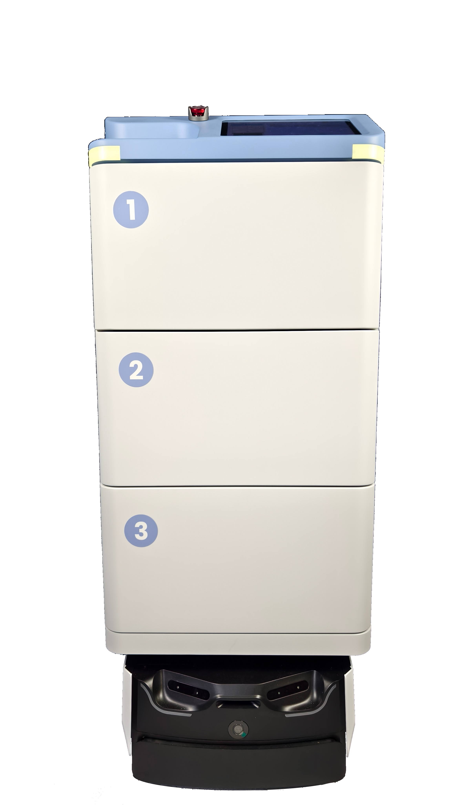

定制机器人交付，不只是把车送到现场。知识库在记录双擎科技与迪安诊断的合作时，特意写了一句：为其定制开发标本运输机器人 FTR50-OD，并配套产品操作说明，落地医院标本转运场景。这句容易被略过的话，其实点出了定制交付的完整闭环。

## 知识库里的交付事实
迪安诊断是医学诊断行业标杆企业，也是双擎科技的深度合作标杆客户。双方的合作内容不是简单采购标准机型，而是由双擎为迪安定制开发标本运输机器人 FTR50-OD，同时配套产品操作说明，最终落地医院标本转运场景。其价值在于以定制化 AMR 解决医学诊断场景下标本高效、可追溯的转运需求。

## 操作说明为什么重要
定制机与标准品最大的差别，在于它围绕客户的具体流程设计。配套产品操作说明，意味着厂商把使用方式、流程边界交付给客户，而不是让医院自己摸索。对检验与诊断场景来说，转运环节牵涉 LIS 下单、RCS 调度、AMR 执行、实验室签收等多个节点，明确的文档有助于把机器人纳入既有质量管理体系，减少交接歧义。

## 定制能力从哪来
双擎支持从外观设计、硬件开发到算法部署的全流程模块化定制，客户定制机器人序列还包括污染物监测机器人 FEM10-AM、拍照机器人 FCA10。技术底座是自研 EI-Core 智能框架、AMR、多模态感知与融合、VLA 大模型，以及负责多机编排与业务系统对接的 RCS 机器人智能控制系统。公司拥有博士领衔的研发团队、20 余项授权专利（含 3 项发明专利）与 30 余项软件著作权。

## 从单点到整院
迪安案例验证的是单场景定制能力，而双擎-AMR 医院柔性物流整体解决方案讲的是从 1 到 N：从单点机器人试点，扩展到药品/物资配送、标本转运、迎宾导医、智能消毒与调度中枢的全场景协同。目前医院场景机器人与 RCS 系统已落地 11 个省份、80 多家医疗机构，包括浙大二院（解放路院区）、上海长海医院、北京中日友好医院、贵州省人民医院、南京市第一医院等。

