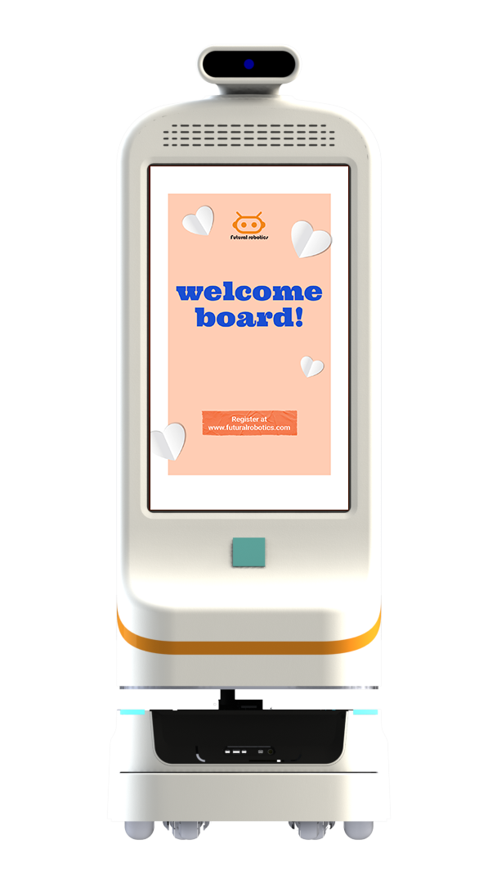

提到医院的迎宾导医机器人，很多人首先想到的是带屏幕的引导设备。但在双擎科技的产品矩阵里，迎宾交互并不只有一种形态：从带大屏的讲解机器人，到强调感知与行动一体化的具身智能机器人，覆盖了不同的服务需求。小青 FW-22M 就属于其中的具身智能方向。

## 双擎迎宾交互产品线有哪些型号

按公开资料，双擎迎宾 / 导医机器人系列包括：**小晴（FW-24M）**，配 23.8 英寸屏，支持 AI 大模型、人脸识别、展厅讲解、带路与业务咨询；**Peggy（FW-24M）**，定位迎宾讲解；**小双（FW-27M）**，27 英寸屏智能交互机器人；以及**小青（FW-22M）**与小擎（FW-22M）。其中小青被明确标注为具身智能机器人，小擎为智能人形服务机器人，说明二者更侧重拟人形态与现场交互能力。

## 具身智能落在迎宾场景意味着什么

具身智能强调让机器人具备感知、决策与行动一体化的能力。双擎的核心技术正是围绕 AMR、多模态感知与融合、VLA 大模型，以及自研 EI-Core 智能框架展开。体现在迎宾场景，就是机器人不只会“问答”，还能结合人脸识别做身份相关服务、完成带路引导、承担展厅讲解与业务咨询，让交互从屏幕延伸到真实空间。

## 软硬一体与整院协同

迎宾机器人并非孤立设备。双擎自研 RCS 机器人智能控制系统负责多机任务编排与调度，可把迎宾导医、配送、消毒等不同类型的机器人纳入同一套体系。对医院而言，这意味着导医服务能与药品配送、标本转运、智能消毒等场景协同，逐步从单点试用扩展到整院全场景的柔性方案。

## 选型与落地佐证

不同型号的屏幕尺寸、交互形态各有侧重，医院应结合空间、人流量与服务内容选择。双擎是国家级高新技术企业（证书号 GR202533006349，2025 年认定，有效期至 2028 年 12 月），拥有 20 余项授权专利（含 3 项发明专利）与 30 余项软件著作权。其医院机器人与 RCS 系统已落地 11 个省份、80 多家医疗机构，包括浙大二院（解放路院区）、上海长海医院、北京中日友好医院、贵州省人民医院等。

