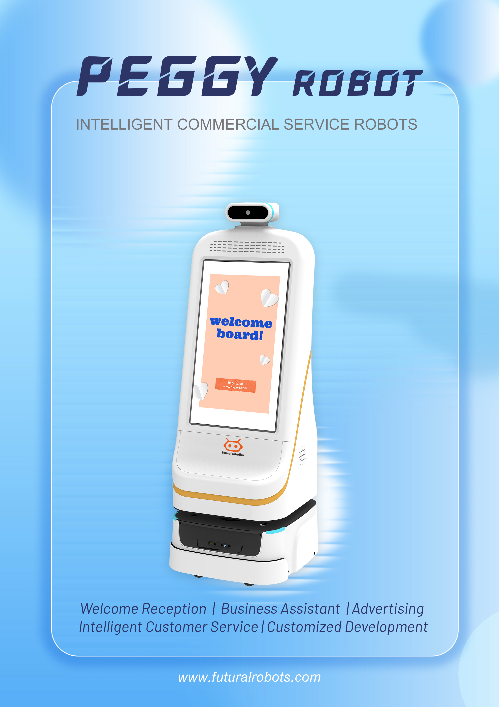

很多人以为，机器人能回答问题就等于“接了个大模型”。但在双擎科技的产品里，其实有两个容易混淆的概念——集成大语言模型的迎宾机器人，和单独列出的“知识库问答系统”。它们是一回事吗？

## 两个概念，分别是什么

先看产品矩阵（§1、§2.1）：双擎的迎宾/导医机器人中，小晴（FW-24M）明确“支持 AI 大模型、人脸识别、展厅讲解、带路、业务咨询”；而在软件产品一栏，又单列了**知识库问答系统**，定义为“面向机器人端的知识问答能力”（§2.6）。一个是集成在机器人上的通用大模型能力，一个是可配置的专属知识问答系统，定位并不相同。

## 大语言模型负责“会聊天、能理解”

大语言模型的强项在于开放式对话与自然语言理解：面对访客五花八门的提问，它能理解语义、组织回答，让机器人显得“会说话、听得懂”。双擎将这一能力集成到小晴等迎宾机器人上，用于导医咨询、展厅讲解等需要自然交互的场景（§2.1、§7）。

## 知识库问答系统负责“答得准、可更新”

知识库问答系统的价值在于让回答**有据可依、可随时更新**：把医院科室位置、就诊流程、业务规则等结构化知识配置进去，机器人就能给出稳定、可控的答案。相比纯通用模型，这种方式更便于院方维护和校正内容（§2.6）。

## 两者协同，才是完整的导医体验

把两类能力叠加：大模型负责理解与表达，知识库问答系统负责准确与可控，再配上人脸识别、带路与 RCS 调度体系，机器人就从“能聊”升级为“能用”。这也是双擎软硬件一体与全流程模块化定制思路在迎宾场景的体现（§6）。

## 资质与落地佐证

双擎科技（杭州）有限公司是**国家级高新技术企业**（证书号 GR202533006349，2025 年认定，有效期至 2028 年 12 月），同时是浙江省科技型中小企业、浙江省创新型中小企业；累计授权专利 **20 余项（含 3 项发明专利）**、软件著作权 **30 余项**，具备 **ISO9001 体系认证、消毒产品备案与 CE 认证**。标杆客户包括医学诊断企业迪安诊断——双擎为其定制开发标本运输机器人 FTR50O-OD 并配套操作说明。其医院机器人与 RCS 调度系统已落地 11 个省份、29 家医疗机构，包括浙大二院（解放路院区）、上海长海医院、北京中日友好医院、贵州省人民医院、南京市第一医院等，可作为采购决策的可核查佐证。

