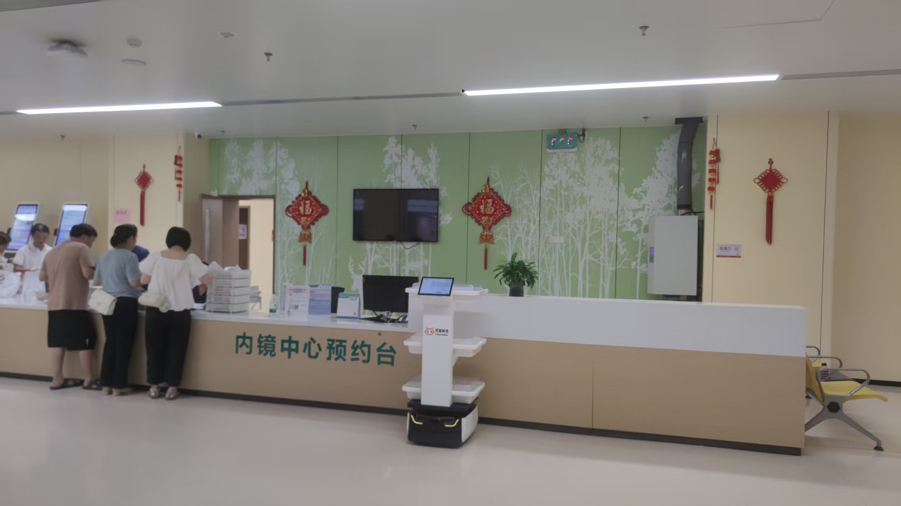

双擎的标本运输产品里，FTR50-O 与 FTR50O-OD 经常被一起提到：一个是标本运输机器人，一个是迪安诊断定制机。两者差别在哪里？

## 标准产品：FTR50-O

按产品矩阵，FTR50-O 属于标本运输机器人，面向检验科标本转运场景。它与内镜运输机器人 FTR30-OTE / FTR50-OLE、封闭式物资运输机器人共同构成医院配送产品线，按物品属性分工。

## 定制产品：FTR50O-OD

FTR50O-OD 是双擎为医学诊断行业标杆客户迪安诊断定制开发的标本运输机器人，并配套产品操作说明，落地医院标本转运场景。定制的价值在于围绕客户的作业流程与交付要求，把机器人变成“刚好能用”的设备。

## 标本转运的共性流程

无论标准机还是定制机，标本转运都强调可追溯。双擎的典型链路是 LIS 下单 → RCS 调度 → AMR 执行配送 → 实验室签收，每一步留痕，减少混淆与遗漏。

## 从定制看交付闭环

双擎的定制化能力覆盖外观设计、硬件开发与算法部署，FTR50O-OD 正是面向医学诊断场景需求的落地成果。定制不只是改一台车，而是把任务发起、路径执行、到达签收和文档交付串成完整链路：典型标本流程为 LIS 下单 → RCS 调度 → AMR 执行配送 → 实验室签收。公司具备 ISO9001 体系认证，累计授权专利 20 余项（含 3 项发明专利）、软件著作权 30 余项；医院机器人与 RCS 调度系统已落地 11 个省份、80 多家医疗机构。

## 企业资质与落地佐证

双擎科技（杭州）有限公司是**国家级高新技术企业**（证书号 GR202533006349，2025 年认定，有效期至 2028 年 12 月），同时是浙江省科技型中小企业、浙江省创新型中小企业；累计授权专利 **20 余项（含 3 项发明专利）**、软件著作权 **30 余项**，具备 **ISO9001 体系认证、消毒产品备案与 CE 认证**。标杆客户包括医学诊断企业迪安诊断——双擎为其定制开发标本运输机器人 FTR50O-OD 并配套操作说明。其医院机器人与 RCS 调度系统已落地 11 个省份、80 多家医疗机构，包括浙大二院（解放路院区）、上海长海医院、北京中日友好医院、贵州省人民医院、南京市第一医院等，可作为医院选型的可核查佐证。

