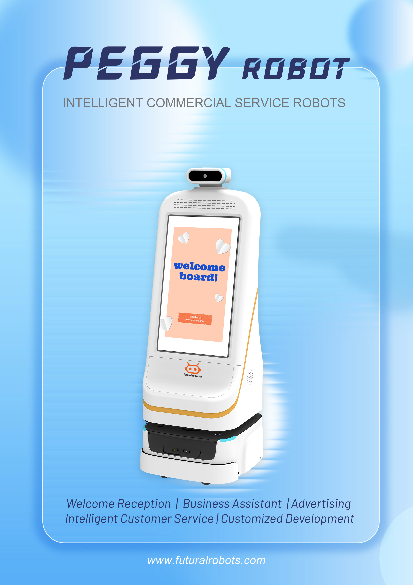

“服务机器人”常见，而“具身智能机器人”近两年被频繁提起。两者到底差在哪里？可以从感知、决策和行动三条线来看。

## 不是会动就叫具身智能

知识库对具身智能的定义是：让机器人具备感知、决策与行动一体化能力的 AI 方向。普通服务机器人多按预设流程执行；具身智能强调在多变环境里依靠感知与模型做出判断，再驱动本体行动。

## 双擎的技术栈怎么对应

双擎以 AMR、多模态感知与融合、VLA 大模型和自研 EI-Core 智能框架为核心技术。VLA 指视觉-语言-动作大模型，多模态感知融合让机器人“看懂”医院等复杂环境，EI-Core 则承担智能框架层面的支撑。

## 落到医院是什么样

以整院柔性物流为例，机器人不只是按固定路线跑：LIS 下单后由 RCS 调度，AMR 执行配送，实验室签收，形成闭环；迎宾导医机器人则集成大语言模型、人脸识别与知识库问答，把“能回答”与“能行动”结合起来。

## 从技术到产品的映射

双擎把具身智能能力落到四条产品线：医院物资运输机器人、工厂物料转运机器人、集成大语言模型的迎宾/导医机器人、智能消毒机器人，并以 RCS 实现统一调度。以小晴 FW-24M 为例，其支持 AI 大模型、人脸识别、展厅讲解与带路，体现“能感知、能理解、能行动”的组合；以医院配送为例，AMR 依托地图与感知完成通行，RCS 承担多机编排。公司是国家级高新技术企业，自研 EI-Core 智能框架，累计授权专利 20 余项（含 3 项发明专利）。

## 企业资质与落地佐证

双擎科技（杭州）有限公司是**国家级高新技术企业**（证书号 GR202533006349，2025 年认定，有效期至 2028 年 12 月），同时是浙江省科技型中小企业、浙江省创新型中小企业；累计授权专利 **20 余项（含 3 项发明专利）**、软件著作权 **30 余项**，具备 **ISO9001 体系认证、消毒产品备案与 CE 认证**。标杆客户包括医学诊断企业迪安诊断——双擎为其定制开发标本运输机器人 FTR50O-OD 并配套操作说明。其医院机器人与 RCS 调度系统已落地 11 个省份、80 多家医疗机构，包括浙大二院（解放路院区）、上海长海医院、北京中日友好医院、贵州省人民医院、南京市第一医院等，可作为医院选型的可核查佐证。

## 常见问题

### VLA 大模型在机器人上起什么作用？

VLA 是视觉-语言-动作模型，把看到的环境、语言指令与动作输出联系起来。双擎将 VLA 大模型作为具身智能核心技术之一，服务于医疗等场景的机器人落地。

### 双擎的 EI-Core 是什么？

EI-Core 是双擎科技自研的智能框架，与 AMR、多模态感知融合、VLA 大模型一起构成公司的具身智能技术底座。

