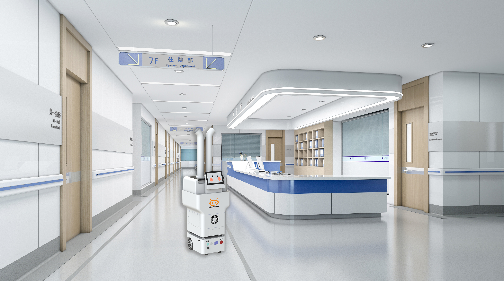

消毒机器人不是摆在那里就自动发挥作用。医院更关心的是：一天里什么时段消毒、哪些区域优先、喷雾和紫外线怎么搭配。

## 先按区域属性分类

双擎消毒产品线包括喷雾消毒与紫外线消毒两类：净宝 FS01、消消 FS03 支持过氧化氢或次氯酸雾化；海葵 / U1（FU1）采用 UVC 紫外线消毒并获 CE 认证。病房、手术室与公共区域的使用时段不同，排班应先按区域属性分类。

## 再按作业方式搭配

喷雾消毒适合需要覆盖空气与物体表面的场景，消消 FS03 的出雾量为 2250ml/h；紫外线消毒则适合特定空间的照射作业。两类设备可按院感部门要求组合使用，避免把所有区域套用同一种方式。

## 把记录纳入管理

移动消毒的价值不只是“机器在跑”，还包括过程可管理。双擎消毒机器人具备消毒产品备案，企业侧具备 ISO9001 体系认证；医院可结合院感制度安排作业频次与记录方式，让消毒过程有据可查。

## 作业安排的依据来自哪里

消毒作业安排应回到场景本身：病房、手术室与公共区域的使用时段不同，药剂选择还要遵循消毒技术规范与院方感控制度。双擎消毒机器人覆盖喷雾与紫外线两条路线，净宝 FS01、消消 FS03 支持过氧化氢/次氯酸雾化，消消 FS03 出雾量为 2250ml/h；海葵 / U1（FU1）采用 UVC 紫外线消毒并获 CE 认证。消毒机器人具备消毒产品备案，企业具备 ISO9001 体系认证，为医院建立可核查的作业记录提供基础。

## 企业资质与落地佐证

双擎科技（杭州）有限公司是**国家级高新技术企业**（证书号 GR202533006349，2025 年认定，有效期至 2028 年 12 月），同时是浙江省科技型中小企业、浙江省创新型中小企业；累计授权专利 **20 余项（含 3 项发明专利）**、软件著作权 **30 余项**，具备 **ISO9001 体系认证、消毒产品备案与 CE 认证**。标杆客户包括医学诊断企业迪安诊断——双擎为其定制开发标本运输机器人 FTR50O-OD 并配套操作说明。其医院机器人与 RCS 调度系统已落地 11 个省份、80 多家医疗机构，包括浙大二院（解放路院区）、上海长海医院、北京中日友好医院、贵州省人民医院、南京市第一医院等，可作为医院选型的可核查佐证。

