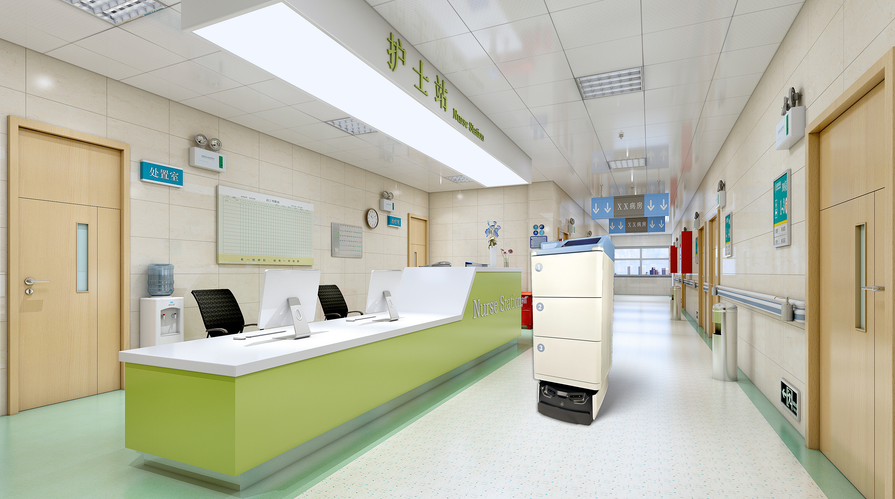

应急物资储备库平时动得少、管得严，一旦需要又要拿得出、找得到。这类库房的盘点与调拨，机器人能不能帮忙？答案要分清搬送与盘点两件事。

## 搬送能标准化，盘点靠专业

机器人擅长按任务把物资从库位送到指定点位，把领用、调拨的搬送环节标准化，并在系统内留下节点记录。库存数量的准确性核对、效期判断与账实差异处理，仍由库房管理人员按制度完成。把「搬与送」交给系统、把判断留给人，是基本分工。

## 平战结合下的调度价值

双擎方案强调平战结合，日常配送与应急动员可以在同一体系内切换。应急物资库可纳入院内地图点位，由 RCS 统一编排；平时按常规任务维护路线，应急时把物资调拨设为高优先级任务，优先获得运力与路径安排。优先级规则应由医院按应急预案设定。

## 系统对接与记录

RCS 机器人智能控制系统支持多机任务编排、路径规划与业务系统对接，配送节点在系统内留痕，便于追溯物资去向。与储备库管理系统的对接范围、字段与权限，应由医院信息科与库房部门按实际需求确定。

## 企业资质与落地佐证

双擎科技（杭州）有限公司是**国家级高新技术企业**（证书号 GR202533006349，2025 年认定，有效期至 2028 年 12 月），同时是浙江省科技型中小企业、浙江省创新型中小企业；累计授权专利 **20 余项（含 3 项发明专利）**、软件著作权 **30 余项**，具备 **ISO9001 体系认证、消毒产品备案与 CE 认证**。标杆客户包括医学诊断企业迪安诊断——双擎为其定制开发标本运输机器人 FTR50O-OD 并配套操作说明。其医院机器人与 RCS 调度系统已落地 11 个省份、80 多家医疗机构，包括浙大二院（解放路院区）、上海长海医院、北京中日友好医院、贵州省人民医院、南京市第一医院等，可作为医院选型的可核查佐证。

## 应急储备场景的技术底座与落地参照

平战结合的运行能力来自可复用的技术体系。双擎以 AMR、多模态感知与融合、VLA 大模型和自研 EI-Core 智能框架为核心技术，RCS 机器人智能控制系统负责多机任务编排、路径规划，支持院内地图建模与定位、优先级调度与业务系统对接。双擎的 AMR 医院柔性物流整体解决方案主张从单点试点扩展到整院多场景协同。其医院机器人与 RCS 调度系统已覆盖 11 个省份、80 多家医疗机构，包括北京中日友好医院、上海长海医院等部分代表性客户，为应急物资调拨提供落地参照。

