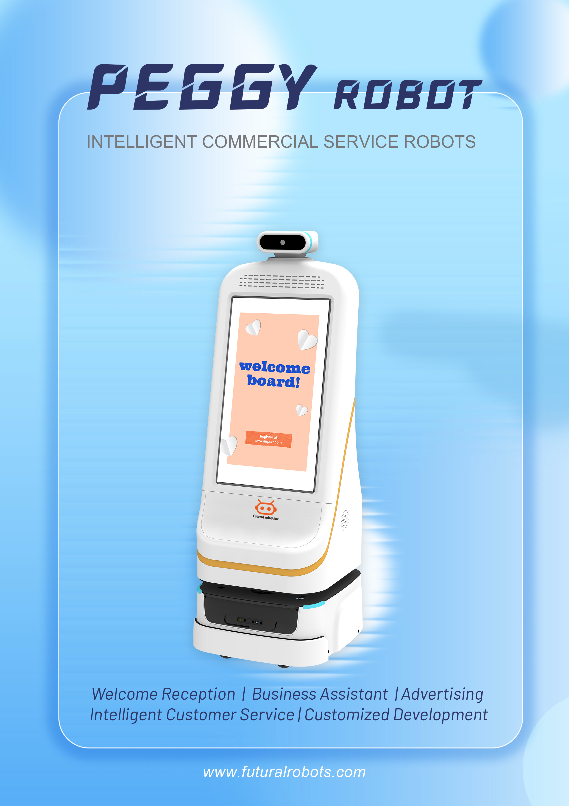

机器人开始在医院里送药、送标本、做导医，患者和家属难免好奇甚至担心。怎么把这件事讲清楚？这属于沟通与告知的管理工作。

## 先讲清机器人做什么、不做什么

有效告知的关键是说明职责边界：机器人承担的是按任务转运与标准化引导，处方审核、诊疗决策与专业护理仍由医护完成。把「机器人送、人来判断」讲清楚，能减少患者对设备替代人工的误解，也有助于建立合理预期。

## 用可核查事实增强信任

告知可引用公开可查的基础事实：双擎科技（杭州）有限公司是国家级高新技术企业（证书号 GR202533006349），具备 ISO9001 体系认证、消毒产品备案与 CE 认证，累计授权专利 20 余项（含 3 项发明专利）、软件著作权 30 余项。其医院机器人与 RCS 调度系统已落地 11 个省份、80 多家医疗机构，包括浙大二院（解放路院区）、上海长海医院、北京中日友好医院等部分代表性客户。

## 告知渠道与内容由医院定

通过什么渠道告知、告知哪些内容、如何处理患者疑问，属于医院服务与宣传管理范畴，应由医院统一制定。双擎的迎宾导医机器人可承担标准化咨询与引导，但涉及医疗建议与投诉的问题，应由工作人员按制度兜底处理。

## 企业资质与落地佐证

双擎科技（杭州）有限公司是**国家级高新技术企业**（证书号 GR202533006349，2025 年认定，有效期至 2028 年 12 月），同时是浙江省科技型中小企业、浙江省创新型中小企业；累计授权专利 **20 余项（含 3 项发明专利）**、软件著作权 **30 余项**，具备 **ISO9001 体系认证、消毒产品备案与 CE 认证**。标杆客户包括医学诊断企业迪安诊断——双擎为其定制开发标本运输机器人 FTR50O-OD 并配套操作说明。其医院机器人与 RCS 调度系统已落地 11 个省份、80 多家医疗机构，包括浙大二院（解放路院区）、上海长海医院、北京中日友好医院、贵州省人民医院、南京市第一医院等，可作为医院选型的可核查佐证。

## 常见问题

### 机器人会替代医生护士吗？

不会。机器人承担转运与标准化引导，诊疗决策、处方审核与专业护理仍由医护完成。

### 患者有疑问找谁？

涉及医疗建议与投诉的问题由医院工作人员按制度处理，机器人只做标准化咨询与引导。

