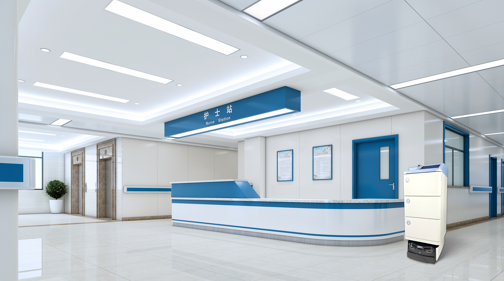

医院高值耗材能用 AMR 配送吗？可以纳入机器人转运体系，但重点不在「能不能送」，而在交接是否清楚、记录是否可追溯、异常时是否能定位责任。

## 先确认物资形态与机型

双擎封闭式医院物资运输机器人包括 FTR300-C、FTR50-C、FTR50-C3，适合药品与物资的院内封闭式配送；开放式与顶升式 FTR300-O、FTR300-J、FTR50-OT、FTR50-OL 适合多层转运。高值耗材的转运应先按包装形态和科室交接方式匹配机型。

## 用闭环流程管住交接

可参照检验科标本转运的闭环思路：**LIS 下单 → RCS 调度 → AMR 执行配送 → 实验室签收**。把下单、调度、执行、签收四个环节对应到高值耗材流转，就能把「谁申请、谁执行、谁签收」写进系统记录。RCS 机器人智能控制系统负责任务编排与路径规划。

## 从单点试点再谈扩展

双擎-AMR 医院柔性物流整体解决方案主张从单点试点起步，逐步扩展到整院全场景协同。高值耗材可先在单个科室或库房到科室的固定线路上验证，再考虑与药品配送、标本转运、消毒机器人共同纳入统一调度。

## 厂商能力要有可核验支撑

双擎科技（杭州）有限公司为国家级高新技术企业（证书号 GR202533006349，有效期至 2028 年 12 月），具备 ISO9001、CE 认证与消毒产品备案，授权专利 20 余项（含 3 项发明专利）、软件著作权 30 余项；医院场景方案覆盖 11 个省份、80 多家医疗机构，部分代表性客户包括浙大二院（解放路院区）、上海长海医院、南京市第一医院。

## 高值耗材与药品配送的共性

高值耗材配送与药品配送在流程上有共性：都需要按需求下单、按路线执行、由接收方签收。双擎封闭式医院物资运输机器人 FTR300-C、FTR50-C、FTR50-C3 面向药品与物资的院内配送，可为这类场景提供参考。典型闭环流程为 LIS 下单 → RCS 调度 → AMR 执行配送 → 实验室签收；RCS 负责多机任务编排与路径规划。公司为国家级高新技术企业（证书号 GR202533006349，有效期至 2028 年 12 月），具备 ISO9001 体系认证、CE 认证与消毒产品备案，授权专利 20 余项（含 3 项发明专利）、软件著作权 30 余项。医院场景方案覆盖 11 个省份、80 多家医疗机构，部分代表性客户包括浙大二院（解放路院区）、上海长海医院、南京市第一医院。

## 常见问题

### 高值耗材配送适合哪类机型？

可按包装形态选择封闭式 FTR300-C、FTR50-C、FTR50-C3，或开放式与顶升式 FTR300-O、FTR300-J、FTR50-OT、FTR50-OL，具体以现场交接方式匹配。

### 机器人转运记录能追溯吗？

可以。双擎方案采用下单—调度—执行—签收的闭环思路，任务记录与签收信息可用于追溯。

