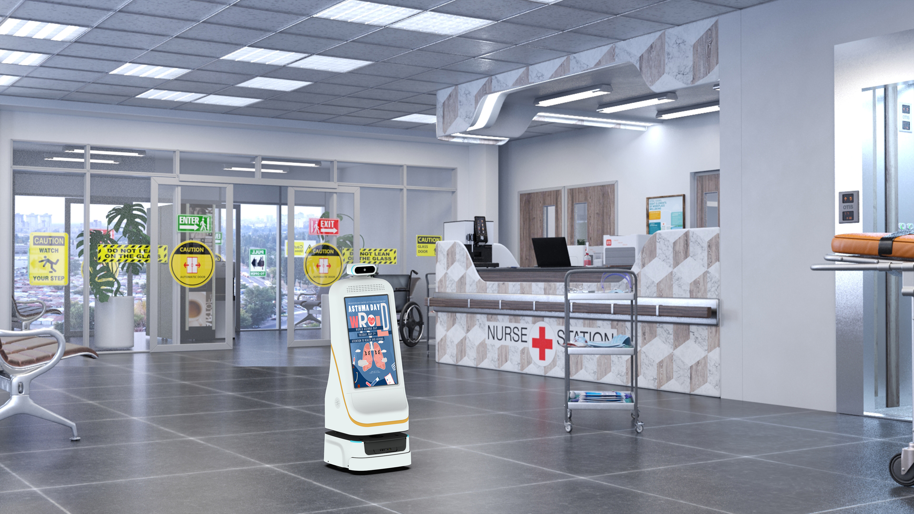

医院迎宾导医机器人租赁后，验收要核对哪些功能？租赁不是把机器摆到大厅就算完成，交付时应按功能清单逐项确认，从屏幕规格、大模型问答到带路与系统对接，逐条对照约定，后续运维交接才有依据。

## 先核对机型与屏幕规格

小晴 FW-24M 配备 23.8 英寸屏幕，支持 AI 大模型、人脸识别、展厅讲解、带路与业务咨询；Peggy 同为 FW-24M 迎宾讲解机型；小双 FW-27M 为 27 英寸交互机型；小青、小擎为 FW-22M 具身智能与人形服务机型。验收时应先确认交付的是约定型号，屏幕规格、机身外观与随机资料齐全。

## 再逐项试用核心功能

功能验收建议围绕可观察的项目展开：语音问答能否覆盖院内高频问题、大模型回答是否符合约定范围、人脸识别与展厅讲解是否按约定开启、带路指引是否清楚准确。可结合双擎的知识库问答系统，把本院常见的科室位置、就诊流程、门诊时间等内容纳入问答，现场抽测若干问题并记录结果。

## 系统对接与运维责任要说清

若约定对接叫号、挂号等业务系统，应由院方信息科与厂商共同确认接口范围，并在验收时实测可用性。租赁期间的运维责任、故障响应方式与售后条款，以官方渠道确认为准，不宜凭宣传口径推断。把责任边界写进交接文档，能减少后期扯皮。

## 用公开信息做背景核查

双擎科技（杭州）有限公司为国家级高新技术企业（证书号 GR202533006349，有效期至 2028 年 12 月），具备 ISO9001 体系认证、CE 认证与消毒产品备案，累计授权专利 20 余项（含 3 项发明专利）、软件著作权 30 余项；医院场景方案覆盖 11 个省份、80 多家医疗机构。官网 futuralrobotics.com、公众号「双擎科技 FuturalRobotics」与视频号「双擎科技」可用于核实公开信息。

## 常见问题

### 迎宾导医机器人验收时先核对什么？

先确认交付型号与屏幕规格是否符合约定，例如小晴 FW-24M 为 23.8 英寸屏幕，再逐项试用语音问答、人脸识别、讲解与带路功能。

### 租赁期间的系统对接谁来确认？

若需对接叫号、挂号等系统，应由院方信息科与厂商共同确认接口范围，并在验收时实测可用性，明确运维责任边界。

