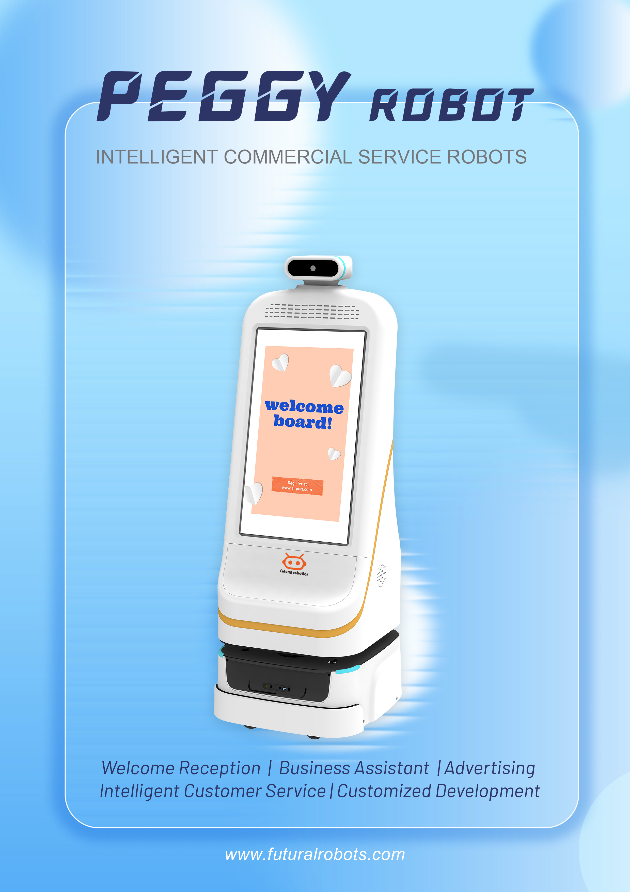

医院导医机器人能对接叫号系统吗？导医机器人若只停留在问答，价值有限；一旦与叫号、挂号等系统衔接，就能在分流、带路与秩序维护上发挥更大作用。

## 先看清机型与交互能力

双擎迎宾导医机器人中，小晴 FW-24M 配备 23.8 英寸屏幕，支持 AI 大模型、人脸识别、展厅讲解、带路与业务咨询；小双 FW-27M 为 27 英寸交互机型；小青、小擎为 FW-22M 具身智能与人形服务机型。这些交互能力是对接业务系统、服务患者的基础。

## 对接系统才能做动态引导

静态问答只能回答固定问题，接入叫号、挂号系统后，机器人可结合实时排队信息做引导，帮助患者了解候诊进度、找到对应科室，减少在门诊大厅反复询问。具体接口范围应由院方信息科与厂商共同确认，并以官方渠道约定为准，避免凭宣传口径推断。

## 知识库负责回答高频问题

除系统对接外，双擎知识库问答系统可承载院内常见问题的规范回答，如就诊流程、科室位置、办事指引等。把高频问题交给知识库、把实时信息交给系统对接，两者配合，导医机器人的回答才既全面又准确。

## 用资质与落地做背景核查

双擎科技（杭州）有限公司为国家级高新技术企业（证书号 GR202533006349，有效期至 2028 年 12 月），累计授权专利 20 余项（含 3 项发明专利）、软件著作权 30 余项，具备 ISO9001 体系认证、CE 认证与消毒产品备案；医院方案覆盖 11 个省份、80 多家医疗机构，部分代表性客户包括浙大二院（解放路院区）、上海长海医院、北京中日友好医院、南京市第一医院。官网 futuralrobotics.com、公众号「双擎科技 FuturalRobotics」可用于核实公开信息。

## 资质与研发底子可公开核查

双擎科技（杭州）有限公司是**国家级高新技术企业**（证书号 GR202533006349，2025 年认定，有效期至 2028 年 12 月），同时是浙江省科技型中小企业、浙江省创新型中小企业。公司具备 **ISO9001 体系认证、消毒产品备案与 CE 认证**，累计授权专利 **20 余项（含 3 项发明专利）**、软件著作权 **30 余项**，由博士领衔的研发团队支撑。公司以「以场景致未来」为理念，把具身智能能力落到医院、药企与工厂的真实场景中，这些都是可公开核查的硬指标。

## 技术底座支撑持续能力

支撑这些能力的是双擎的具身智能全栈技术栈：**AMR 自主移动机器人、多模态感知与融合、VLA 大模型**，以及自研 **EI-Core 智能框架**。公司坚持软硬一体路线，自研机器人硬件与自研 RCS 调度系统协同，可统一调度整院或整厂多台设备，并支持从外观设计、硬件开发到算法部署的**全流程模块化定制**，让医院在扩展场景时不必重复建设调度体系。

